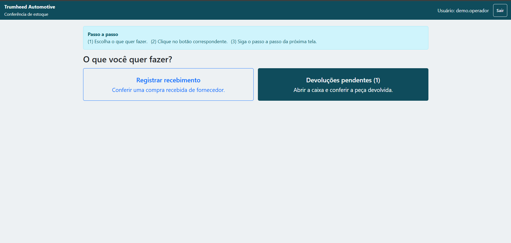
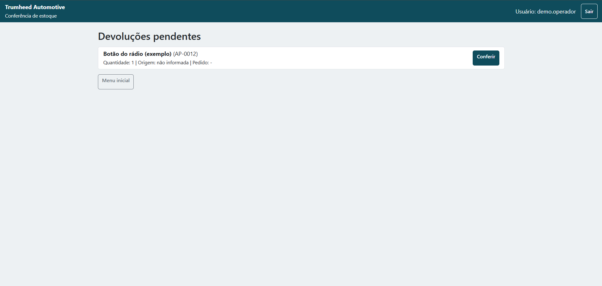
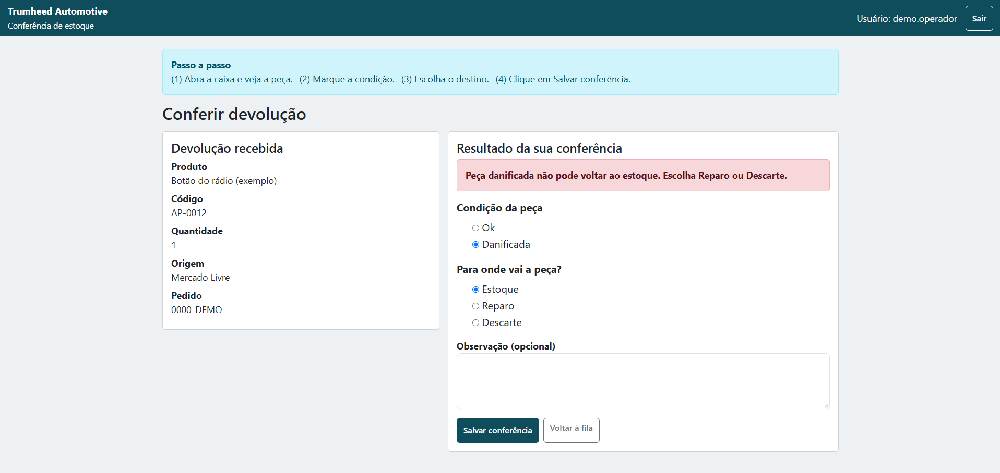
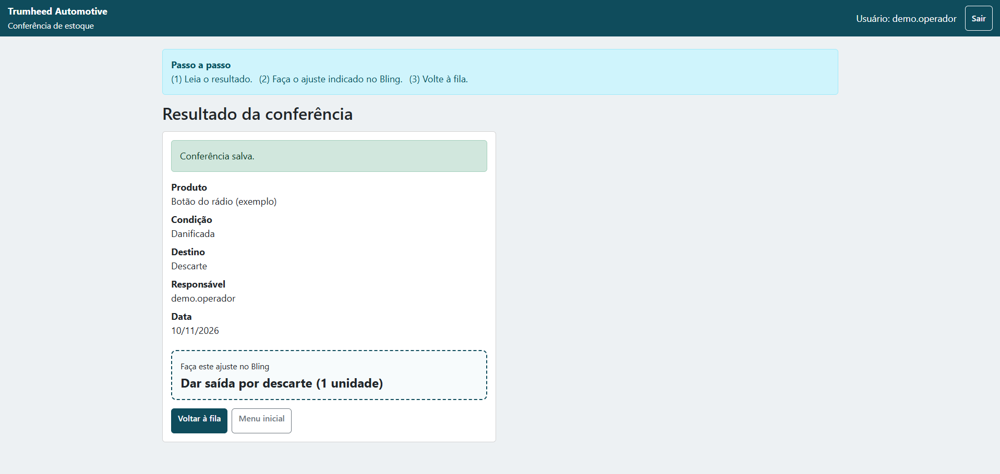
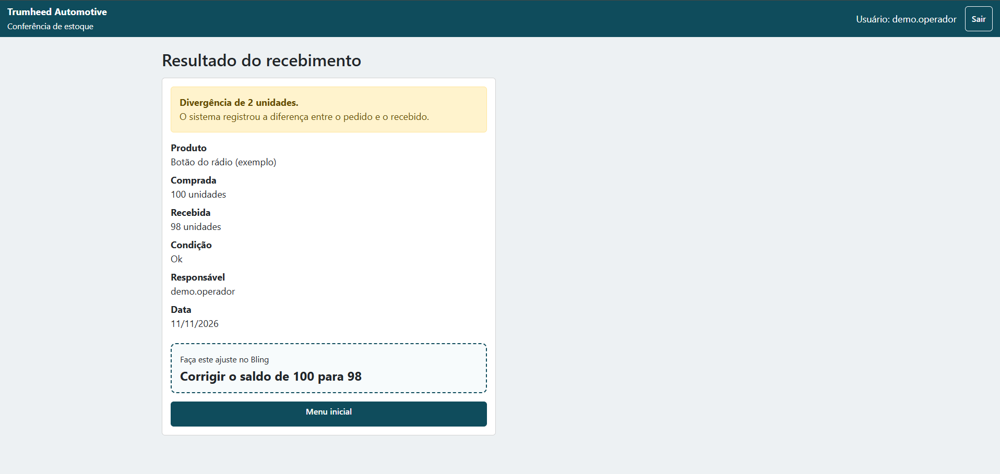
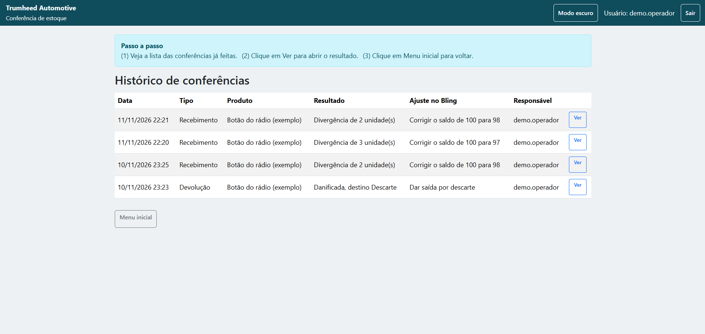
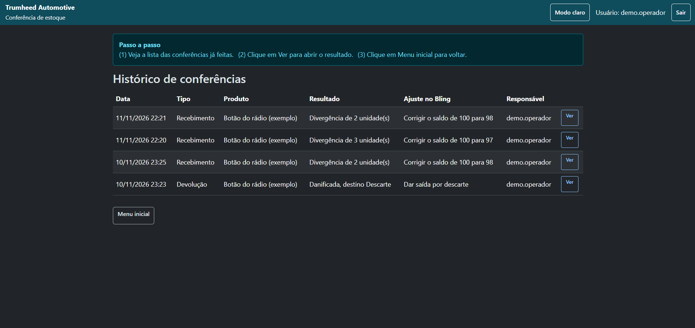

# Trumheed Automotive: conferência de estoque

Sistema web para conferir compras de fornecedores e devoluções de clientes antes de o estoque ser considerado disponível. Desenvolvido na disciplina de Projeto de Software a partir de um diagnóstico feito com uma microempresa de autopeças de São Paulo/SP, que vende em marketplaces.

Sistema no ar: https://trumheed-conferencia-estoque.onrender.com

Observações: o sistema está hospedado no plano gratuito do Render, então o primeiro acesso pode levar alguns segundos. Todas as telas exigem login; para acessar a demonstração, entre em contato pelo [LinkedIn](https://www.linkedin.com/in/douglas-cardoso-dev/).

## Telas

| Menu inicial | Fila de devoluções |
| --- | --- |
|  |  |

| Conferência de devolução | Resultado da conferência |
| --- | --- |
|  |  |

| Recebimento com divergência | Histórico |
| --- | --- |
|  |  |

| Modo escuro |
| --- |
|  |

## Problema

A loja usa um ERP para controlar o estoque. As compras eram lançadas sem abrir a caixa, e as devoluções do marketplace eram somadas ao estoque automaticamente, sem nenhuma verificação da peça. Isso já tinha causado furo de estoque e o risco de vender de novo uma peça danificada.

## O que o sistema faz

- Registro de recebimento de compras, com aviso de divergência entre a quantidade comprada e a recebida.
- Fila de devoluções, com condição da peça (ok ou danificada) e destino (estoque, reparo ou descarte).
- Bloqueio de peça danificada: ela não pode voltar ao estoque.
- Indicação do ajuste a fazer no ERP (nesta versão, feito manualmente).
- Histórico de conferências.
- Modo escuro em todas as telas.
- Rota /saude/ para monitoramento da aplicação.

Fora do escopo do MVP: integração com a API do ERP, conferência na embalagem e funções de ERP (notas fiscais, financeiro e precificação).

## Validação com o parceiro

O MVP foi validado em duas rodadas com o dono da loja e com quem opera o estoque no dia a dia. Os ajustes pedidos nas rodadas viraram novas funcionalidades, como o histórico de conferências e o modo escuro.

## Tecnologias

- Back-end: Python 3.12 e Django 5.2 LTS
- Front-end: templates do Django com Bootstrap 5.3
- Banco de dados: PostgreSQL em produção (psycopg 3) e SQLite no desenvolvimento
- Deploy: Render, com Gunicorn e WhiteNoise para os arquivos estáticos
- Monitoramento: UptimeRobot consultando a rota /saude/
- Qualidade: testes unitários e de integração e pipeline de CI no GitHub Actions

## Como o projeto foi desenvolvido

Cada etapa foi feita em uma branch própria e integrada à main por pull request com auto-revisão, usando commits semânticos (feat, test, ci, docs e chore). O pipeline de CI roda a cada pull request e a cada push na main.

## Como executar o projeto

Pré-requisitos: Python 3.12 e Git instalados.

(1) Clonar o repositório e entrar na pasta:

    git clone https://github.com/DouglasCardoso26/trumheed-conferencia-estoque.git
    cd trumheed-conferencia-estoque

(2) Criar e ativar o ambiente virtual.

No Windows (PowerShell):

    py -3.12 -m venv .venv
    .venv\Scripts\Activate.ps1

No Linux ou macOS:

    python3.12 -m venv .venv
    source .venv/bin/activate

(3) Instalar as dependências:

    pip install -r requirements.txt

(4) Definir as variáveis de ambiente de desenvolvimento (exemplo completo no arquivo .env.example).

No Windows (PowerShell):

    $env:DJANGO_DEBUG = "1"

No Linux ou macOS:

    export DJANGO_DEBUG=1

(5) Criar o banco de dados e um usuário de teste:

    python manage.py migrate
    python manage.py createsuperuser

(6) Iniciar o servidor e abrir http://127.0.0.1:8000/ no navegador:

    python manage.py runserver

Para cadastrar produtos e devoluções de teste, use a área administrativa em http://127.0.0.1:8000/admin/.

## Como rodar os testes

    python manage.py test

O pipeline de CI (arquivo .github/workflows/ci.yml) verifica o projeto, confere se não faltam migrações e roda todos os testes.

## Regras de negócio cobertas por testes

(1) Divergência de recebimento: quantidade comprada menos quantidade recebida. Exemplo real: 100 comprados e 98 recebidos geram divergência de 2 e o ajuste "Corrigir o saldo de 100 para 98".

(2) Devolução com peça danificada não pode voltar ao estoque; só pode ir para reparo ou descarte.

(3) Todas as telas exigem login.

## Segurança e privacidade

Nenhum segredo fica no repositório: a chave secreta, o banco de produção e as demais configurações vêm de variáveis de ambiente (veja .env.example). Em produção, o HTTPS é obrigatório e os cookies de sessão são seguros. O sistema não guarda dados pessoais de clientes, e todos os dados usados em testes e demonstrações são fictícios.

## Status

MVP publicado e validado com o parceiro em duas rodadas. Próximos passos possíveis: integração com a API do ERP para fazer o ajuste de estoque automaticamente.

## Autor

Douglas Cardoso

[LinkedIn](https://www.linkedin.com/in/douglas-cardoso-dev/) | [GitHub](https://github.com/DouglasCardoso26)
